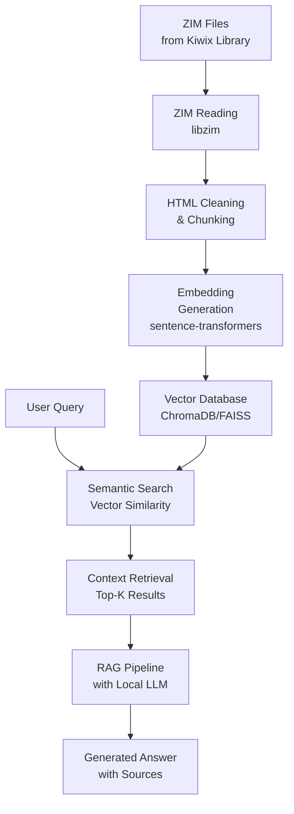

# Dynamic ZIM Library to Vector Database RAG System
This project turns ZIM files (the compressed offline Wikipedia/Stack Exchange/docs archives from Kiwix) into a vector database for Retrieval-Augmented Generation (RAG) with Large Language Models, giving you an offline knowledge base.

This is a good solution for running local LLMs on underpowered computers while providing access to extensive knowledge bases. By leveraging pre-compressed ZIM files and efficient vector search, you can have an AI assistant with encyclopedic knowledge without requiring high-end hardware or constant internet connectivity.

## Architecture Overview


## Features
- **Dynamic ZIM Library**: Discovers every ZIM file in a library directory. New files are added to the database incrementally; already indexed files are skipped
- **Resumable builds**: Articles are streamed and indexed in batches with constant memory use. Progress is checkpointed, so an interrupted build continues where it stopped
- **Clean text extraction**: Strips scripts, styles, references, navigation boxes and other page furniture, keeps paragraphs, and turns infobox/table rows into `key | value` lines
- **Flexible Vector Databases**: ChromaDB or FAISS (with a SQLite side table for text and metadata)
- **Local LLM Support**: Docker Model Runner by default; Ollama, OpenAI-compatible servers (LM Studio, llama.cpp, vLLM), OpenAI and Anthropic are also supported
- **RAG with citations**: Answers cite numbered excerpts, and each excerpt shows its article title and source ZIM file
- **Interactive chat**: Ask many questions without reloading models
- **Export**: Export clean text (or raw HTML) to JSON or JSON Lines

## Quick Start

### 1. Install Dependencies
```bash
./setup.sh
source zim_rag_env/bin/activate
```

### 2. Add ZIM Files to Library
Download ZIM files from [Kiwix Library](https://library.kiwix.org/) or the [Wikimedia Dump](https://dumps.wikimedia.org/other/kiwix/zim/wikipedia/) and place them in the `zim_library` directory:

```bash
# Example: a tiny Wikipedia selection (~2 MB) to try things out
curl -L -o zim_library/wikipedia_en_ray-charles_nopic_2026-08.zim \
  https://download.kiwix.org/zim/wikipedia/wikipedia_en_ray-charles_nopic_2026-08.zim

# List available ZIM files
python zim_rag.py list-zim
```

### 3. Build Vector Database
> **⚠️ Important Note**: The first build can take a very long time depending on the ZIM file size and your machine. Large ZIM files (2GB+) may take several hours on slower machines. You can stop a build with Ctrl-C and run `build` again later to resume.
```bash
# Build from all ZIM files in library (only new files are processed on later runs)
python zim_rag.py build

# Or build from specific ZIM files
python zim_rag.py build --zim-file "wikipedia_en_medicine_maxi_2023-12.zim"

# Limit articles per ZIM file for faster processing
python zim_rag.py build --limit 1000
```

### 4. Set Up Docker Model Runner (Recommended)
Install Docker Desktop, enable Model Runner, and pull the default model:
```bash
docker model pull ai/smollm3:Q4_K_M
```
The system talks to Model Runner's OpenAI-compatible API at `http://localhost:12434`. If host TCP access is disabled, enable it with `docker desktop enable model-runner --tcp 12434`; otherwise the `docker model run` CLI is used as a slower fallback.

### 5. Query the Knowledge Base
```bash
# Semantic search (no LLM needed)
python zim_rag.py query "What are treatments for PTSD?"

# Full RAG with LLM generation
python zim_rag.py rag-query "Explain the latest developments in military medicine"

# Interactive session
python zim_rag.py chat

# Get system information
python zim_rag.py info
```

## Commands
`config.json` in the current directory is loaded automatically. Use `--config PATH` to load another file and `-v` for debug logging. Each of these goes before the command name.

### Build Vector Database
```bash
python zim_rag.py build [OPTIONS]

Options:
  --zim-file TEXT        ZIM file (name in the library, or a path); repeatable. Default: all
  --limit INTEGER        Limit number of articles per ZIM file
  --force                Delete the existing database and rebuild it
  --embedding-model TEXT Override the configured embedding model
```

### Query Commands
```bash
# Semantic search only
python zim_rag.py query [OPTIONS] QUESTION

Options:
  --k INTEGER        Number of chunks to retrieve [default: retrieval_k]
  --source TEXT      Only search chunks from this ZIM file
  --json             Print results as JSON

# RAG with LLM generation
python zim_rag.py rag-query [OPTIONS] QUESTION

Options:
  --k INTEGER        Number of chunks to retrieve [default: retrieval_k]
  --source TEXT      Only search chunks from this ZIM file
  --no-sources       Do not list the source excerpts

# Interactive RAG session (same options as rag-query)
python zim_rag.py chat
```

### Library Management Commands
```bash
# List all ZIM files in library and their index status
python zim_rag.py list-zim

# Show library and database information
python zim_rag.py info

# Remove a ZIM file's chunks from the database
python zim_rag.py remove wikipedia_en_medicine_maxi_2023-12.zim
```

### Export Commands
```bash
python zim_rag.py export [OPTIONS]

Options:
  --zim-file TEXT       ZIM file to export; repeatable. Default: all
  --output TEXT         Output file [default: zim_articles.json]
  --limit INTEGER       Limit number of articles per ZIM file
  --format [json|jsonl] Output format [default: from the file extension]
  --html                Export raw HTML instead of clean text
```

## Configuration
Settings are read from `config.json` in the current directory. All keys are optional, and unknown keys are reported as errors:
```json
{
  "zim_library_path": "./zim_library",
  "embedding_model": "BAAI/bge-small-en-v1.5",
  "vector_db_type": "chroma",
  "chunk_size": 1000,
  "chunk_overlap": 200,
  "persist_directory": "./vector_db",
  "collection_name": "zim_articles",
  "llm_provider": "docker_model_runner",
  "llm_model": "ai/smollm3:Q4_K_M",
  "retrieval_k": 5,
  "max_articles_per_zim": null
}
```

| Option | Default | Description |
| --- | --- | --- |
| `zim_library_path` | `./zim_library` | Directory scanned for `*.zim` files |
| `embedding_model` | `BAAI/bge-small-en-v1.5` | sentence-transformers model |
| `embedding_query_prefix` / `embedding_document_prefix` | auto | Instruction prefixes; detected automatically for bge and e5 models |
| `embedding_device` | auto | `cpu`, `cuda` or `mps` |
| `embedding_batch_size` | `64` | Embedding batch size |
| `vector_db_type` | `chroma` | `chroma` or `faiss` |
| `chunk_size` / `chunk_overlap` | `1000` / `200` | Chunk length and overlap, in characters |
| `min_article_length` | `200` | Pages with less clean text than this are skipped |
| `persist_directory` | `./vector_db` | Where the database is stored |
| `collection_name` | `zim_articles` | Name of the collection; several can share a directory |
| `llm_provider` | `docker_model_runner` | `docker_model_runner`, `ollama`, `openai` or `anthropic` |
| `llm_model` | per provider | e.g. `ai/smollm3:Q4_K_M`, `llama3.2`, `claude-opus-5-5` |
| `llm_base_url` | per provider | Override the API endpoint, e.g. for LM Studio or llama.cpp |
| `llm_temperature` / `llm_max_tokens` | provider default | Generation settings |
| `llm_timeout` | `300` | Seconds before an LLM request fails |
| `retrieval_k` | `5` | Chunks retrieved per question |
| `max_context_chars` | `8000` | Maximum characters of excerpts sent to the LLM |
| `max_articles_per_zim` | `null` | Default for `build --limit` |

### Embedding Models
- `BAAI/bge-small-en-v1.5` (default: fast, strong retrieval for English)
- `all-MiniLM-L6-v2` (fastest, lower retrieval quality)
- `BAAI/bge-base-en-v1.5` (higher quality, slower)
- `intfloat/multilingual-e5-small` (multilingual support)

The database records which model it was built with, and queries always use that model. To switch models, rebuild with `build --force`.

### Vector Database Types
- `chroma`: ChromaDB (recommended, persistent, metadata-rich)
- `faiss`: FAISS exact inner-product search with chunk text in SQLite (no server, simple files)

### LLM Providers
| Provider | Endpoint | Notes |
| --- | --- | --- |
| `docker_model_runner` | `http://localhost:12434/engines/v1` | Default. `docker model pull ai/smollm3:Q4_K_M` |
| `ollama` | `http://localhost:11434/v1` | `ollama pull llama3.2` |
| `openai` | OpenAI, or any OpenAI-compatible server via `llm_base_url` | Needs `OPENAI_API_KEY` for OpenAI; set `llm_model` |
| `anthropic` | Anthropic Messages API | Needs `ANTHROPIC_API_KEY`; default model `claude-opus-5-5` |

Reasoning text that some local models emit (`<think>...</think>`, e.g. SmolLM3 or Qwen3) is removed from answers.

## System Requirements
### Dependencies
- Python 3.10+
- libzim (installed from PyPI wheels)
- sentence-transformers, chromadb, faiss-cpu
- For LLMs: Docker Desktop with Model Runner, Ollama, or an API key

### Hardware Requirements
- **RAM**: 4GB minimum, 8GB+ recommended
- **Storage**: Roughly 1-3x the size of the text in your ZIM files for the vector database
- **GPU**: Optional, but recommended for faster embedding generation (CUDA or Apple Silicon `mps` are picked automatically)

## Troubleshooting
### Memory Issues
Builds stream articles, so memory use does not grow with ZIM size. If you still run out:
- Lower `embedding_batch_size`
- Use smaller chunk sizes
- Consider using FAISS instead of ChromaDB

### Performance Optimization
- Choose an appropriate embedding model size
- Adjust chunk size based on content type
- Use `--limit` to try settings on a sample first

### Common Errors
- **"Vector database not found"**: run `python zim_rag.py build` first
- **"Existing database was built with embedding model ..."**: rebuild with `--force` or set `embedding_model` back
- **"Model ... not found"**: pull the model (`docker model pull ...` or `ollama pull ...`)
- **"contains a database from an older version"**: databases from earlier versions of this tool must be rebuilt with `build --force`

## ZIM Library Management
### Adding ZIM Files
1. **Download from Kiwix Library**: Visit https://library.kiwix.org/ or the [Wikimedia Dump](https://dumps.wikimedia.org/other/kiwix/zim/wikipedia/)
2. **Place in library directory**: Copy ZIM files to `./zim_library/`
3. **Scan library**: Run `python zim_rag.py list-zim` to see available files
4. **Update database**: Run `python zim_rag.py build`. Only the new files are processed

### Replacing a ZIM File With a Newer Version
```bash
python zim_rag.py remove wikipedia_en_medicine_maxi_2023-12.zim
rm zim_library/wikipedia_en_medicine_maxi_2023-12.zim
python zim_rag.py build
```

## Examples
### Multi-Source Queries
```bash
# Query across all ZIM files
python zim_rag.py rag-query "What are the current treatments for PTSD?"

# Restrict a question to one ZIM file
python zim_rag.py rag-query "How do I install packages?" --source alpinelinux_en_all_maxi_2026-07.zim

# Research medical and technical topics
python zim_rag.py rag-query "How do neural networks relate to brain function?"
```

### Export and Analysis
```bash
# Export clean text from all ZIM files
python zim_rag.py export --output all_articles.json

# Export from a specific ZIM file as JSON Lines
python zim_rag.py export --zim-file "fas-military-medicine_en_2025-06.zim" --output military_medicine.jsonl

# Export sample articles as raw HTML
python zim_rag.py export --limit 100 --html --output sample_articles.json
```

### Advanced Build Options
```bash
# Build with a different embedding model
python zim_rag.py build --force --embedding-model BAAI/bge-base-en-v1.5

# Use a separate config (e.g. FAISS in another directory)
python zim_rag.py --config faiss.json build
```

## Development
```bash
pip install -r requirements-dev.txt
python -m pytest tests
```
The tests build small ZIM files with libzim and use a fake embedder, so they run offline in a few seconds.

## Contributing
1. Fork the repository
2. Create a feature branch
3. Make your changes
4. Run the tests
5. Submit a pull request

## License
This project is open source. Please check the license file for details.

## Support
For issues and questions:
1. Check the troubleshooting section
2. Review the logs in `zim_rag.log`, or rerun the command with `-v`
3. Open an issue with relevant details
